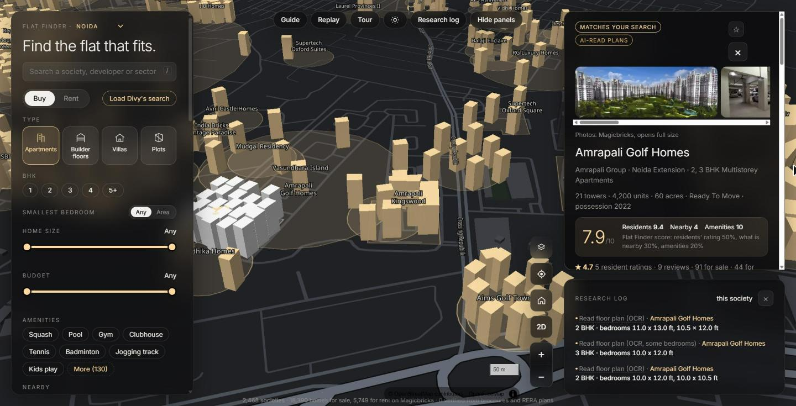

# Noida Flat Finder

Every housing society in **Noida, Greater Noida and Noida Extension** on one 3D night map. Choose rent or buy, set your budget, BHK, home size, amenities, what should be nearby and the smallest bedroom you can live with, and watch the societies that fit light up. Every number links to where it came from.

This is the Noida edition of [Flat Finder](https://github.com/kairothq/flat-finder) by Divy Kairoth, which was built for Gurugram. The Gurugram data from the original is kept and still selectable from the city menu.



## What is in it

Data snapshot taken on 2026-11-20. Listings change daily, so re-run the pipeline for fresh numbers.

| | Noida | Gurugram (from the original) |
|---|---|---|
| Projects listed on Magicbricks | 2,682 | 2,708 |
| Societies on the map | 2,468 | 2,561 |
| Homes for rent (live listings) | 5,749 | 7,371 |
| Homes for sale (live listings) | 18,390 | 22,018 |
| Societies with bedroom sizes read from floor plans | 320 (216 with every bedroom read) | 564 |
| Societies checked by hand from brochures or RERA plans | 0 | 11 |
| Societies within 1.5 km of a metro station | 1,016 | 568 |

Noida is built from two Magicbricks city lists, `noida` and `greater-noida`, so Noida Extension (Greater Noida West), Greater Noida and the Yamuna Expressway are included. 48 projects are not on the map because Magicbricks gives them coordinates outside the area (one "Sector 70" project is placed in Bengaluru); the site counts them as "not located" instead of guessing.

## Run it

You need [Node.js](https://nodejs.org) 20 or newer. The data is in the repo, so no pipeline run is needed to use the site.

```bash
git clone https://github.com/AmanUpadhyay29/noida-flat-finder.git
cd noida-flat-finder/web
npm ci
npm run dev
```

Open http://localhost:5173/?city=noida.

## Using the site

- **Buy or Rent** at the top switches every price, filter and estimate.
- **Filters**: type (apartment, builder floor, villa, plot), BHK, smallest bedroom (by area, in sq ft or gaj), home size, budget, amenities, nearby places (park, metro or rail, school, hospital, mall or supermarket, each within a set distance), ready to move only.
- **Colours**: bright = matches your search; amber = likely (the rooms read so far pass, but not every bedroom has been read); faint outline = not checked yet (no room sizes, so neither a pass nor a fail); dark = does not match.
- **Society card** (click a building): photos, buy and rent medians per BHK with listing counts and ranges, resident ratings and reviews, amenities, bedroom sizes with their source, the price trend since 2021, and links to Google Maps, directions, the floor plans and the Magicbricks page. Owner and broker contacts are on Magicbricks: open the Magicbricks page from the card and use "Contact Owner" or "Contact Agent" on a listing.
- **Score** (0 to 10): residents' rating 50%, what is nearby 30%, amenities 20%, with the parts shown.
- **Research log** shows how each society's data was found.
- **My list**: star societies to shortlist them; the list can be shared as a link.
- **Export**: download every society, every unit type, or just the results your filters match, as CSV.
- Press `/` to search for a society. Useful links: `?city=noida`, `?open=<society id>`, `?map=streets` or `?map=light`, `?nointro`.

To hide Buy everywhere for a rent-only search, set `RENT_ONLY = true` at the top of `web/src/main.js`.

## How bedroom sizes are read

Most trusted first. Each unit on a card says which source it came from.

1. **Checked by hand**: rooms read from builder brochures or RERA plans by a person, page cited (`data/verified/<city>.json`). None for Noida yet; see "Add verified research".
2. **OCR of a floor plan image**: every printed size on a Magicbricks plan is read, each size is paired with its own room label, and the smallest bedroom is computed (`pipeline/plan_ocr.py`). On a Mac this uses the built-in Vision framework. On Windows and Linux it uses [RapidOCR](https://github.com/RapidAI/RapidOCR), which runs locally with no upload (`pipeline/ocr_rapid.py`). A plan counts as fully read only when the number of bedrooms found equals its BHK.
3. **OCR of brochures and HRERA filings** (Gurugram only): `pipeline/brochure_ocr.py`, `pipeline/hrera.py`.
4. **Jev** (optional, needs a key): a typed-answer model the original uses as a cross-check (`pipeline/jev_reader.py`). Not used for Noida.

Sizes are only accepted when they are printed unambiguously: feet and inches with their marks (`11'0"x14'0"`), millimetres (`3350x4270`) or metres. Text like `110X120`, where the foot marks were lost, is skipped rather than guessed, and that society stays "not checked yet". Bedrooms under 8 ft wide are dropped as mis-pairings.

For Noida, 1,950 of 2,992 plan images have been read, which covers every society that had homes for rent at the time; 507 plans were fully read. Plans that are 3D renders without printed sizes are skipped. Spot checks by eye against the plan images (Tata Eureka Park, Godrej Woods, ABA Cleo County) matched exactly.

"Probably fits" uses a cautious smallest-bedroom estimate from the unit's size, fitted on hand-checked rows (Gurugram's 19, until Noida has its own).

## Buy and rent prices

Every society shows buy prices and monthly rents per BHK: medians, ranges and counts of live Magicbricks listings. Where a society has no listings, the site shows **its own estimate, marked "~"**, with the working shown:

- rent from price (or price from rent) using the rental yield measured on society and BHK pairs that have both (Noida: about 2.6% of the price per year, 806 pairs, correlation between log price and log rent 0.87), using the locality's own yield where it has at least 4 pairs;
- when there are no listings at all, unit size x the project's price per sq ft, then rent via yield.

Listing prices that look like typos are flagged with ⚠ and not used for filtering. Known weakness: Magicbricks keeps an old price per sq ft for some projects, which makes a few "~" rents far too low (34 Noida estimates are under ₹7k a month). Real listings never carry "~".

## Rebuild the data

The pipeline is standard-library Python 3.9+. On Windows, set `PYTHONUTF8=1` so the CSV exports keep non-English characters.

```bash
cd pipeline
python mb_crawl.py list noida        # Magicbricks list pages, a few minutes
python mb_crawl.py projects noida    # every project page, polite and cached, about 45 minutes
python osm_fetch.py noida            # OpenStreetMap outlines and nearby places, fetched in tiles
python build_city.py noida           # writes web/public/data/noida*.json, *.geojson, *.csv
```

Reading floor plans (optional, a few hours for a whole city; resumable, saves every 50 plans, societies with homes for rent first):

```bash
python -m venv ../.venv
../.venv/Scripts/pip install -r requirements-ocr.txt     # Linux/macOS: ../.venv/bin/pip
../.venv/Scripts/python plan_ocr.py noida                 # -> data/verified/noida-ocr.json
python build_city.py noida
```

Cities live in `data/cities.json`: a name, one or more Magicbricks city slugs, a bounding box `[south, west, north, east]`, the map centre and zoom, and optionally `osm_tiles` (Noida uses 4, because one OpenStreetMap request for the whole area times out).

## Search from a terminal

```bash
node cli/flatfinder.mjs --data web/public/data/noida.json --rent --bhk 2 --max-rent 25k --min-bedroom "10'6x11'0"
```

Without `--data` the CLI reads from the running site (`http://localhost:5173`, or set `FLATFINDER_SITE`). `node cli/flatfinder.mjs --help` lists every option.

## Tests

```bash
cd pipeline && python -m pytest                 # pip install pytest
cd web && npx vitest run --root .. cli web/src
```

## Add verified research

Hand-checked rows live in `data/verified/<city>.json`. Each unit type lists its bedrooms exactly as printed (`12'10"x16'4"` or millimetres `3350x3750`) with the source URL and page. For Noida, the primary sources are builder brochures and UP RERA filings (up-rera.in). `skills/flat-finder/SKILL.md` describes the process step by step (it is also a Claude Code skill), and "Research this society" on any card opens a GitHub issue for it.

## Changes from the original

- **Noida city**: a `data/cities.json` entry built from two Magicbricks slugs; the crawler accepts a list of slugs and merges them by project id.
- **City box**: `build_city.py` placed societies using a fixed Gurugram box that dropped everything east of longitude 77.3, which is all of Noida. It now uses each city's own box.
- **Tiled OpenStreetMap fetch**: buildings are fetched in a grid of tiles, and a tile that times out on every mirror is split into four.
- **Floor plans on Windows**: RapidOCR engine, Jev cross-check optional, images downloaded as they are read, progress saved and resumed. Windows' built-in OCR was tried first and rejected: it read `3350X4270` as `335014270`.
- **Estimates**: the "probably fits" bedroom model falls back to every city's hand-checked rows when a city has none.
- **Site**: opens on Noida; a `RENT_ONLY` switch; links point to this repo.
- **CLI**: defaults to Noida and to the local site.

The original also runs as an MCP connector for Claude and is hosted on Cloudflare Pages (`web/functions/mcp.js`, `web/wrangler.toml`). This edition is not hosted; the connector code is unchanged.

## Data sources

- **Magicbricks** project pages: listing facts, live sale and rent listings, resident ratings, reviews, photos and floor plan links. The data is © Magicbricks and included here as a snapshot for personal flat hunting; check their terms before reusing it.
- **OpenStreetMap contributors**: building outlines, residential areas, metro stations, parks, schools, hospitals and shops (ODbL).
- **Esri World Imagery** (basemap) and **OpenFreeMap** (roads and city buildings).
- **HRERA Gurugram** and builder brochures: verified Gurugram rows.

Floor plan images and brochures are not stored in this repo, only links to them.

## Credits and licence

Flat Finder was created by [Divy Kairoth](https://github.com/kairothq/flat-finder); this repository keeps its full history. The Noida edition is by [AmanUpadhyay29](https://github.com/AmanUpadhyay29). The code is MIT licensed (see `LICENSE`); the data files are not covered by that licence.
